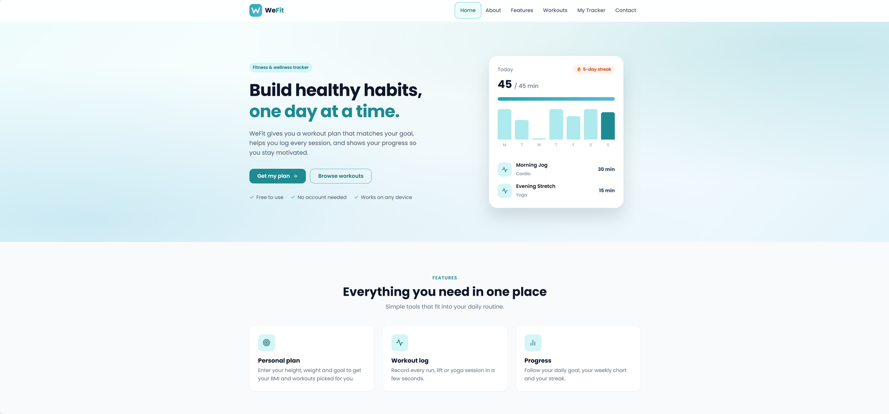
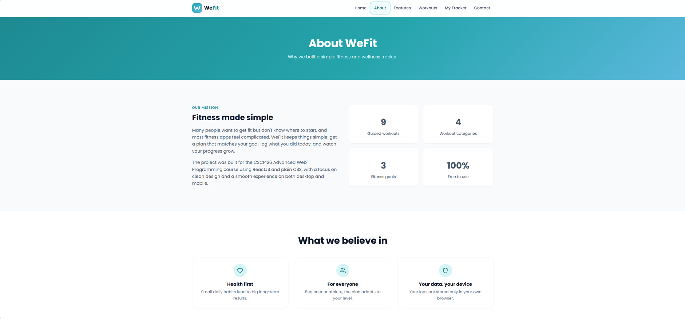
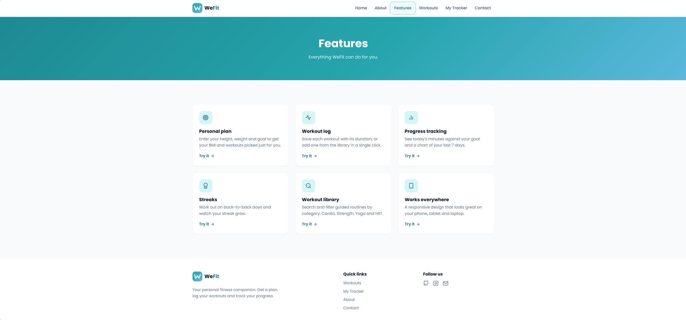
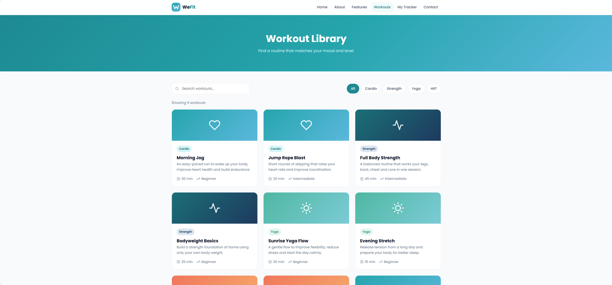
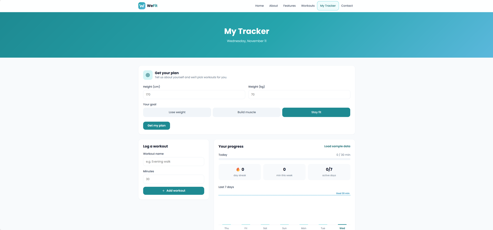
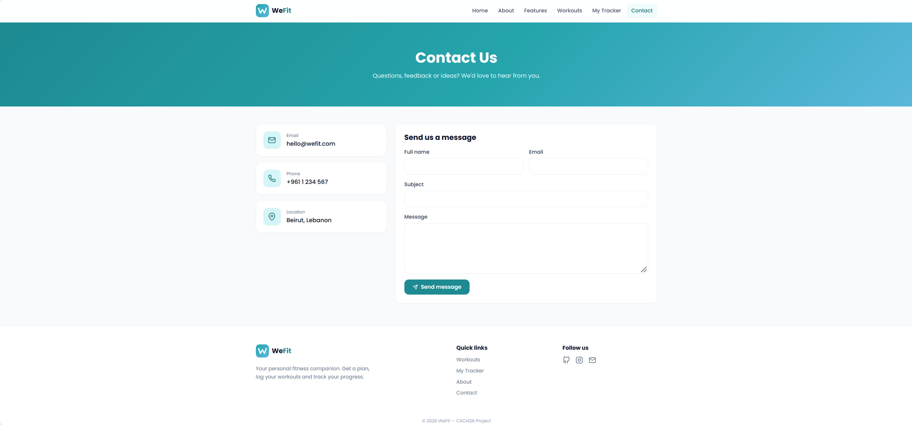

# WeFit — Workout & Wellness Tracker

**CSCI426 Advanced Web Programming — Project Phase 1**

WeFit is a fitness and wellness website based on the **HealthTrack** theme. It helps users build
healthy habits in three steps:

1. **Get your plan** — enter your height, weight and goal (lose weight, build muscle, stay fit) to
   get your BMI, a daily activity goal and workouts recommended for you.
2. **Log workouts** — record each workout you finish, or add one from the library in one click.
3. **Track your progress** — see today's minutes against your goal, your streak and a chart of the last 7 days.

🔗 **Live demo:** https://wefit-blond.vercel.app

## Pages

| Page | Route | Description |
|---|---|---|
| Home | `/` | Landing page: hero, features, how it works, popular workouts |
| About | `/about` | Mission, values and team |
| Features | `/features` | Everything the app can do |
| Workouts | `/workouts` | Workout library with search and category filters |
| Workout details (dynamic) | `/workouts/:id` | Loads a different workout from the URL |
| My Tracker | `/tracker` | Personal plan, workout log and progress chart |
| Contact | `/contact` | Contact form with validation |
| 404 | `*` | Shown for unknown URLs |

## Features

- Personal plan with BMI and recommended workouts
- Workout log (add your own, or one click from a workout page)
- Progress: daily goal bar, streak, weekly total and a 7-day bar chart
- Workout library with search and filters (Cardio, Strength, Yoga, HIIT)
- Responsive design for desktop, tablet and mobile (hamburger menu on phones)
- Data saved in the browser with `localStorage` (no backend in Phase 1)

## Technologies

- [React 19](https://react.dev) with [Vite](https://vite.dev)
- [React Router](https://reactrouter.com) for page navigation
- Plain CSS (CSS variables, Flexbox, Grid and media queries) — one CSS file per component
- [React Icons](https://react-icons.github.io/react-icons/) (Feather icon set)
- Google Fonts: Poppins
- Git & GitHub for version control, Vercel for hosting

## Setup instructions

Requirements: [Node.js](https://nodejs.org) 20 or newer.

```bash
# 1. Clone the repository
git clone https://github.com/bcharagracy/wefit.git
cd wefit

# 2. Install dependencies
npm install

# 3. Start the development server
npm run dev
```

Then open the link shown in the terminal (usually http://localhost:5173).

To create a production build: `npm run build`.

## Project structure

```
src/
├── components/   Reusable parts (Navbar, Footer, WorkoutCard, PlanSection, LogForm, WeeklyChart...)
├── pages/        One file per page, each with its own CSS file
├── data/         Workout data, plan logic (BMI + recommendations) and helper functions
├── hooks/        useLocalStorage (useState that is saved in the browser)
├── App.jsx       Layout and routes
├── main.jsx      Entry point
└── index.css     Global styles: colors, buttons, cards, forms, grids
```

## Screenshots

| Home | About |
|---|---|
|  |  |

| Features | Workouts |
|---|---|
|  |  |

| My Tracker | Contact |
|---|---|
|  |  |

## Team

- Gracy — Computer Science student